# Born2beroot

This README is an English, evidence-linked guide to the Born2beroot Debian virtual machine. It keeps the educational explanations separate from screenshots: images show the VM or terminal output, while all interpretation and instructions are written as Markdown text.

> **Security:** Never publish passwords, LUKS passphrases, private SSH keys, or database secrets. Replace every placeholder before submission.

## Table of contents

- [Virtual machine installation](#virtual-machine-installation)
- [Project goals](#project-goals)
- [Expected system](#expected-system)
- [Installation and storage](#installation-and-storage)
- [Users, groups, and sudo](#users-groups-and-sudo)
- [System administration command reference](#system-administration-command-reference)
- [SSH](#ssh)
- [UFW firewall](#ufw-firewall)
- [Password policy](#password-policy)
- [File permissions and jobs](#file-permissions-and-jobs)
- [Monitoring script](#monitoring-script)
- [AppArmor](#apparmor)
- [Linux filesystem overview](#linux-filesystem-overview)
- [Bonus: WordPress](#bonus-wordpress)
- [Verification checklist](#verification-checklist)
- [Evidence and source files](#evidence-and-source-files)
- [Missing or inconsistent information](#missing-or-inconsistent-information)

## Virtual machine installation

The first part of the project documents creating the Debian VM. The images below are the original installation evidence, shown once and kept in order. They cover VirtualBox storage/controller settings, booting the installer, hostname/domain, disk selection, encrypted LVM, mount points, and final logical-volume choices.

The hostname must end with `42`; the domain can remain empty. Before committing partition changes, verify the encrypted LVM layout and every mount point against the project subject.

<details open>
<summary>Show the 59 VM installation images</summary>

<div align="center">
<figure><a href="README-images/vm-setup/page-001.jpg">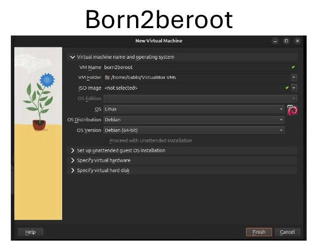</a><figcaption>Step 01: VirtualBox and boot preparation.</figcaption></figure><br>
<figure><a href="README-images/vm-setup/page-002.jpg">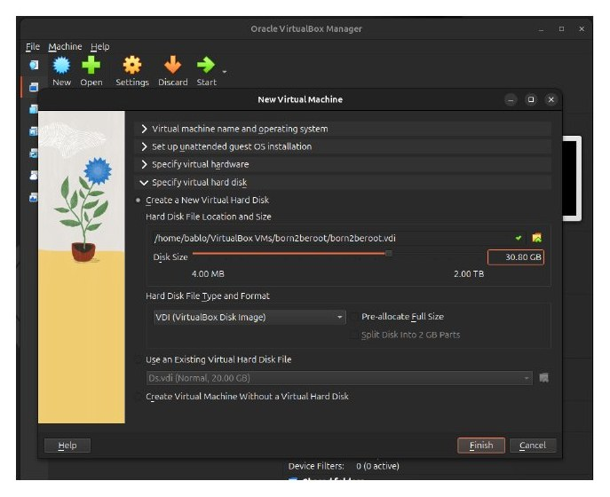</a><figcaption>Step 02: VirtualBox and boot preparation.</figcaption></figure><br>
<figure><a href="README-images/vm-setup/page-003.jpg">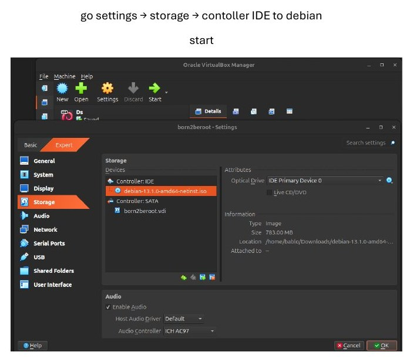</a><figcaption>Step 03: VirtualBox and boot preparation.</figcaption></figure><br>
<figure><a href="README-images/vm-setup/page-004.jpg">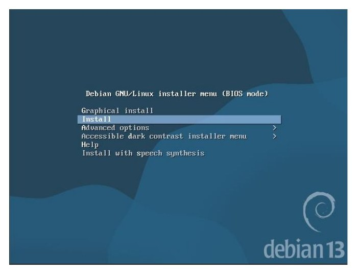</a><figcaption>Step 04: VirtualBox and boot preparation.</figcaption></figure><br>
<figure><a href="README-images/vm-setup/page-005.jpg">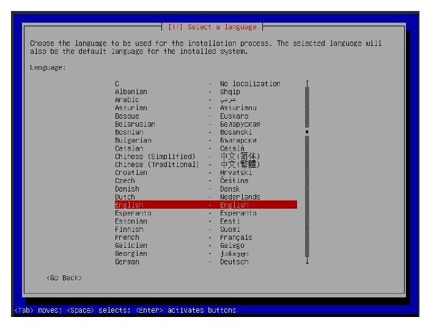</a><figcaption>Step 05: VirtualBox and boot preparation.</figcaption></figure><br>
<figure><a href="README-images/vm-setup/page-006.jpg">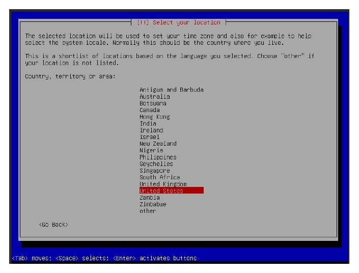</a><figcaption>Step 06: VirtualBox and boot preparation.</figcaption></figure><br>
<figure><a href="README-images/vm-setup/page-007.jpg">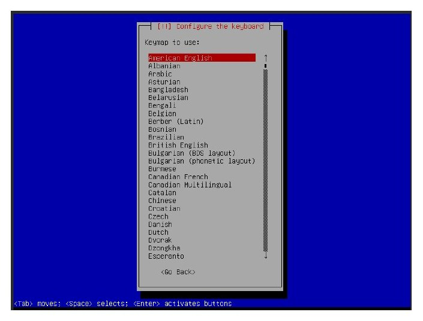</a><figcaption>Step 07: VirtualBox and boot preparation.</figcaption></figure><br>
<figure><a href="README-images/vm-setup/page-008.jpg">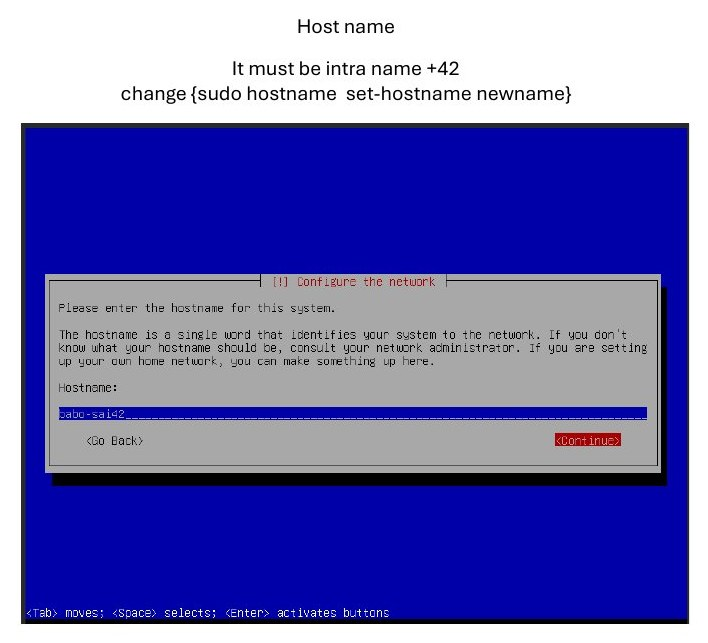</a><figcaption>Step 08: Debian installer configuration.</figcaption></figure><br>
<figure><a href="README-images/vm-setup/page-009.jpg">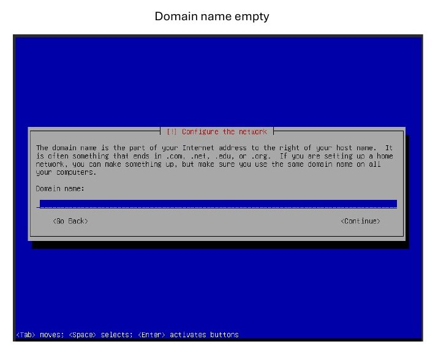</a><figcaption>Step 09: Debian installer configuration.</figcaption></figure><br>
<figure><a href="README-images/vm-setup/page-010.jpg">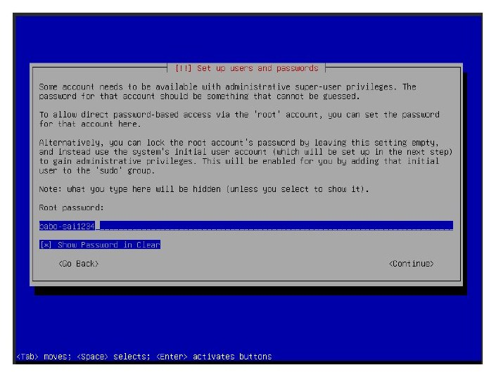</a><figcaption>Step 10: Debian installer configuration.</figcaption></figure><br>
<figure><a href="README-images/vm-setup/page-011.jpg">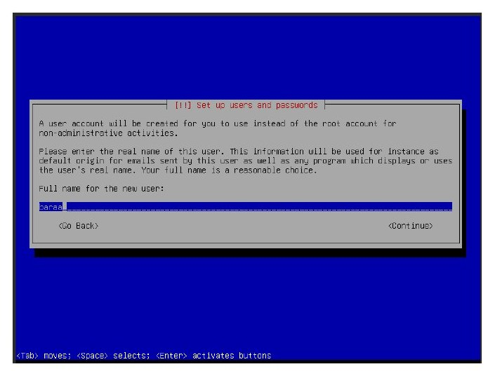</a><figcaption>Step 11: Debian installer configuration.</figcaption></figure><br>
<figure><a href="README-images/vm-setup/page-012.jpg">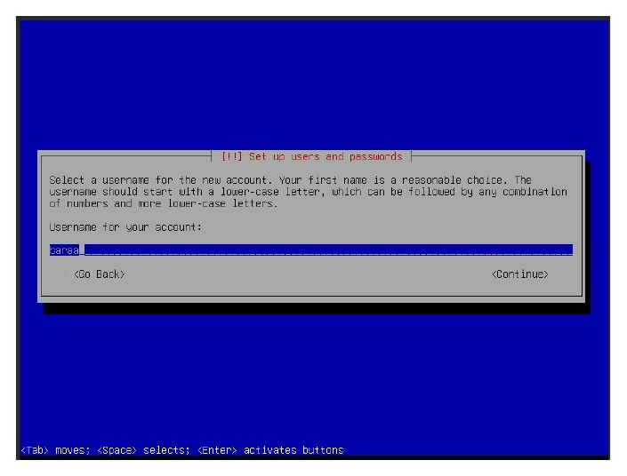</a><figcaption>Step 12: Debian installer configuration.</figcaption></figure><br>
<figure><a href="README-images/vm-setup/page-013.jpg">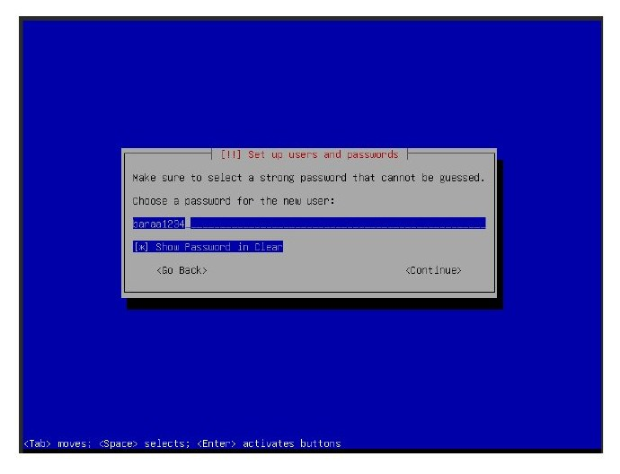</a><figcaption>Step 13: Debian installer configuration.</figcaption></figure><br>
<figure><a href="README-images/vm-setup/page-014.jpg">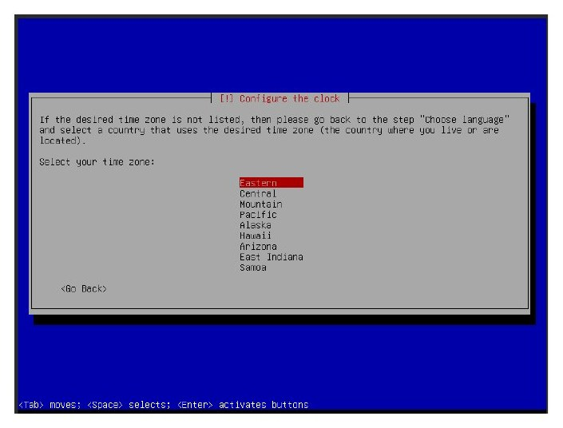</a><figcaption>Step 14: Debian installer configuration.</figcaption></figure><br>
<figure><a href="README-images/vm-setup/page-015.jpg">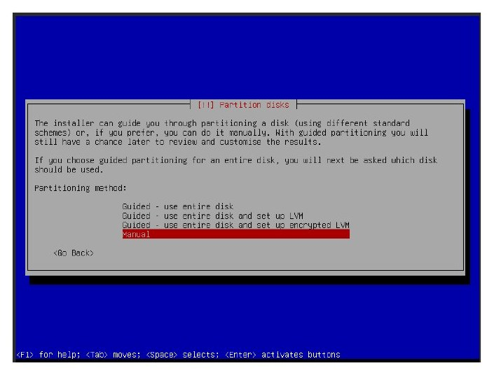</a><figcaption>Step 15: Debian installer configuration.</figcaption></figure><br>
<figure><a href="README-images/vm-setup/page-016.jpg">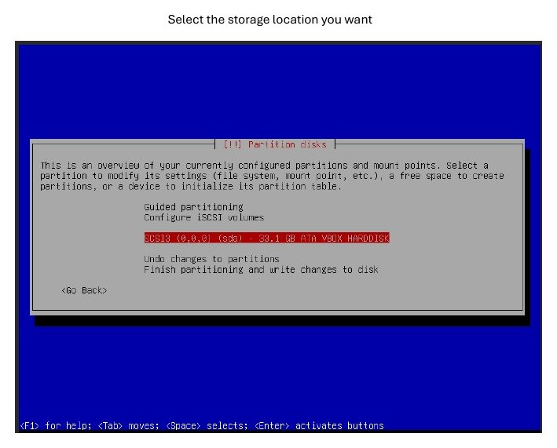</a><figcaption>Step 16: Encrypted storage and partitioning.</figcaption></figure><br>
<figure><a href="README-images/vm-setup/page-017.jpg">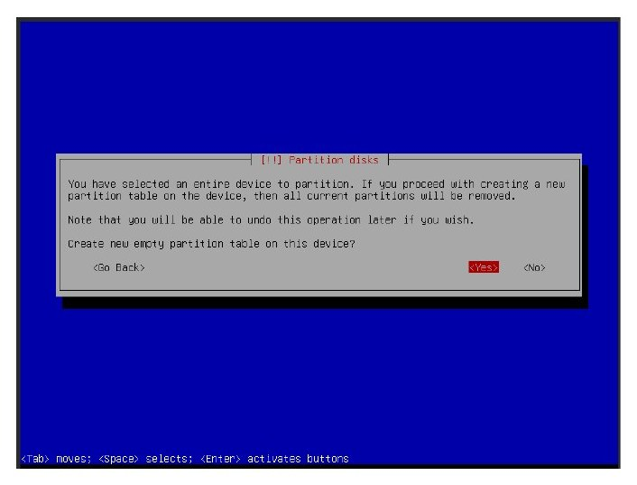</a><figcaption>Step 17: Encrypted storage and partitioning.</figcaption></figure><br>
<figure><a href="README-images/vm-setup/page-018.jpg">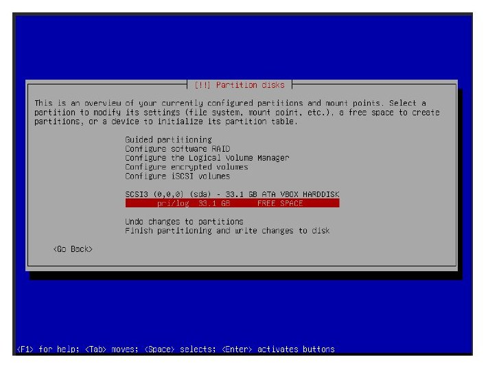</a><figcaption>Step 18: Encrypted storage and partitioning.</figcaption></figure><br>
<figure><a href="README-images/vm-setup/page-019.jpg"></a><figcaption>Step 19: Encrypted storage and partitioning.</figcaption></figure><br>
<figure><a href="README-images/vm-setup/page-020.jpg">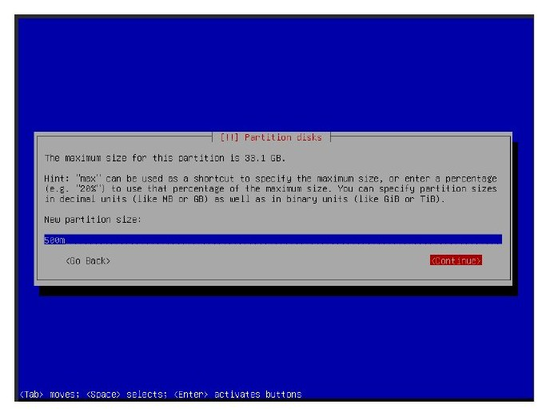</a><figcaption>Step 20: Encrypted storage and partitioning.</figcaption></figure><br>
<figure><a href="README-images/vm-setup/page-021.jpg">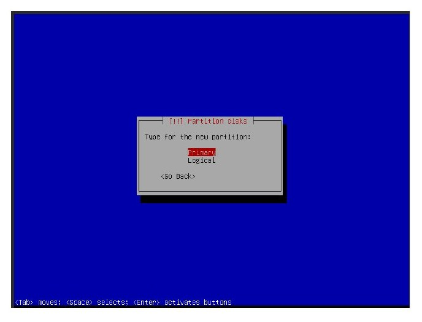</a><figcaption>Step 21: Encrypted storage and partitioning.</figcaption></figure><br>
<figure><a href="README-images/vm-setup/page-022.jpg">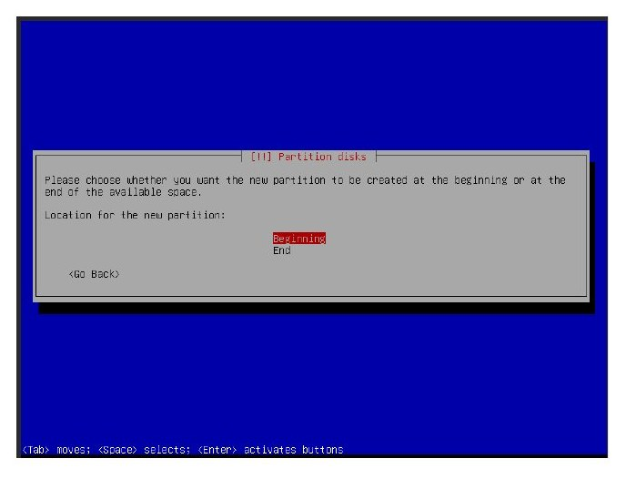</a><figcaption>Step 22: Encrypted storage and partitioning.</figcaption></figure><br>
<figure><a href="README-images/vm-setup/page-023.jpg">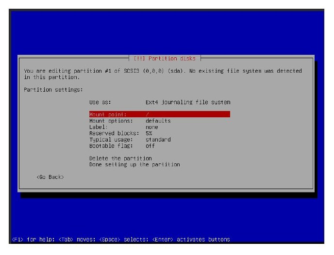</a><figcaption>Step 23: Encrypted storage and partitioning.</figcaption></figure><br>
<figure><a href="README-images/vm-setup/page-024.jpg">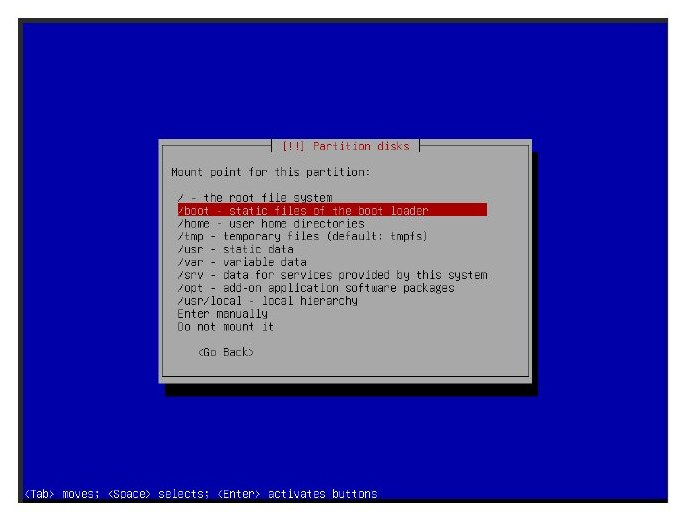</a><figcaption>Step 24: Encrypted storage and partitioning.</figcaption></figure><br>
<figure><a href="README-images/vm-setup/page-025.jpg">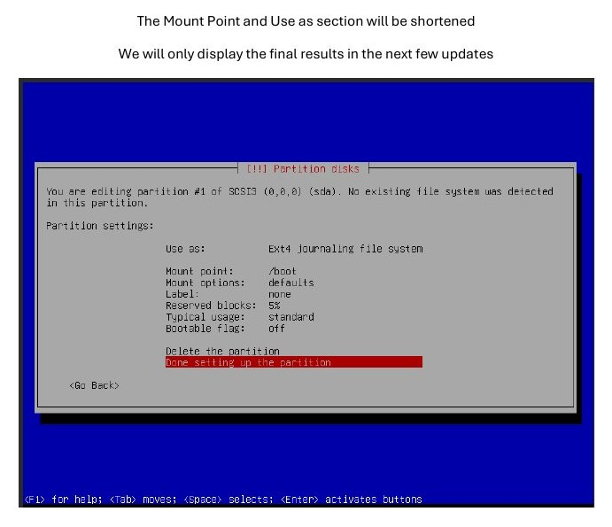</a><figcaption>Step 25: Encrypted storage and partitioning.</figcaption></figure><br>
<figure><a href="README-images/vm-setup/page-026.jpg">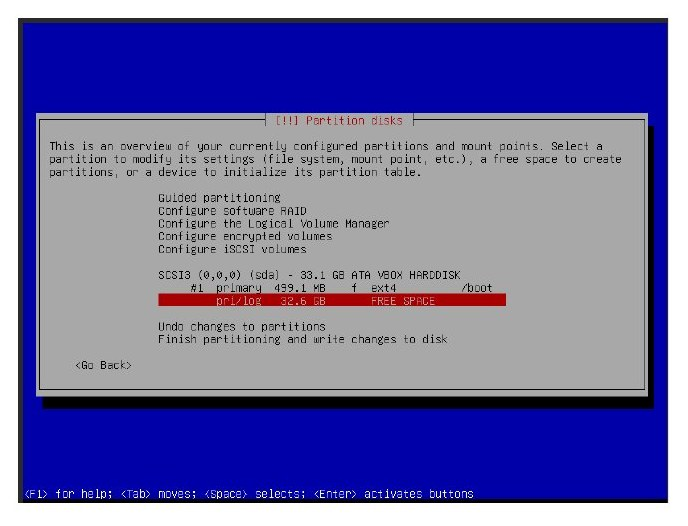</a><figcaption>Step 26: Encrypted storage and partitioning.</figcaption></figure><br>
<figure><a href="README-images/vm-setup/page-027.jpg">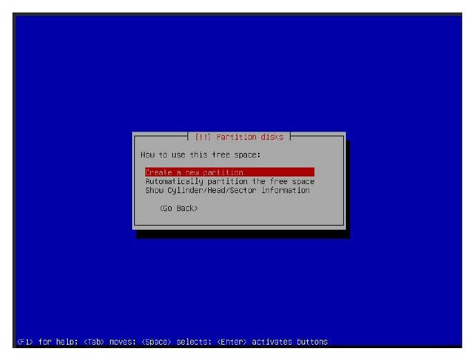</a><figcaption>Step 27: Encrypted storage and partitioning.</figcaption></figure><br>
<figure><a href="README-images/vm-setup/page-028.jpg">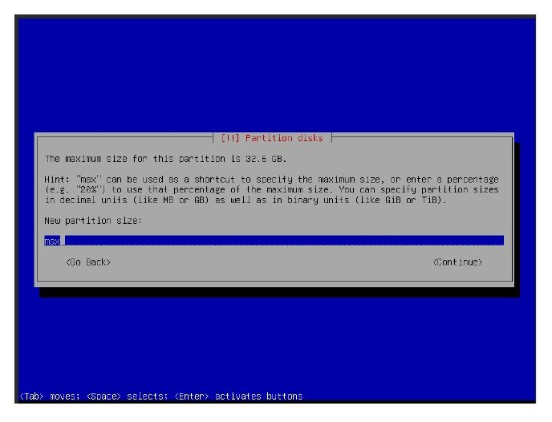</a><figcaption>Step 28: Encrypted storage and partitioning.</figcaption></figure><br>
<figure><a href="README-images/vm-setup/page-029.jpg">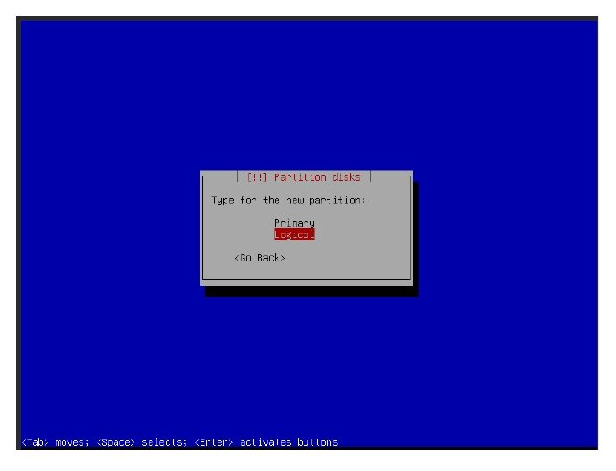</a><figcaption>Step 29: Encrypted storage and partitioning.</figcaption></figure><br>
<figure><a href="README-images/vm-setup/page-030.jpg">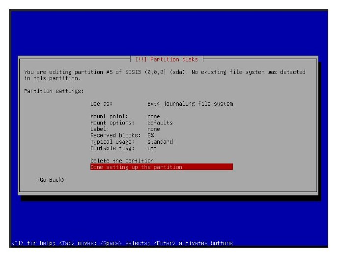</a><figcaption>Step 30: Encrypted storage and partitioning.</figcaption></figure><br>
<figure><a href="README-images/vm-setup/page-031.jpg">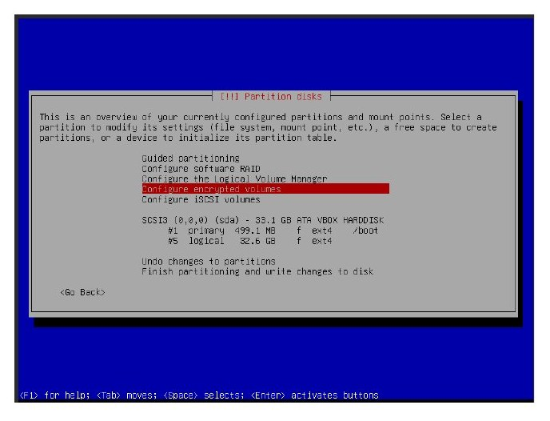</a><figcaption>Step 31: Encrypted storage and partitioning.</figcaption></figure><br>
<figure><a href="README-images/vm-setup/page-032.jpg">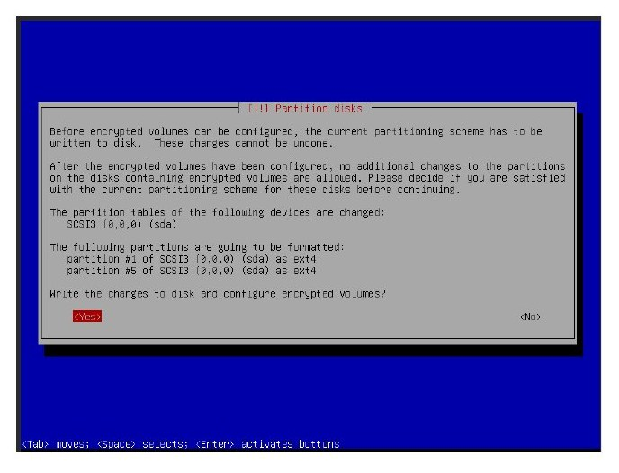</a><figcaption>Step 32: Encrypted storage and partitioning.</figcaption></figure><br>
<figure><a href="README-images/vm-setup/page-033.jpg">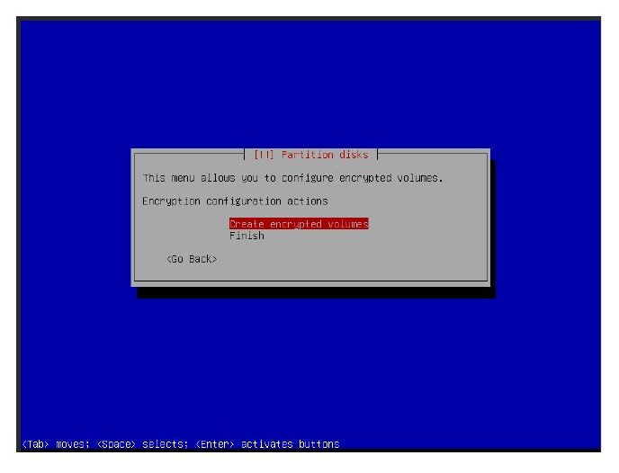</a><figcaption>Step 33: Encrypted storage and partitioning.</figcaption></figure><br>
<figure><a href="README-images/vm-setup/page-034.jpg">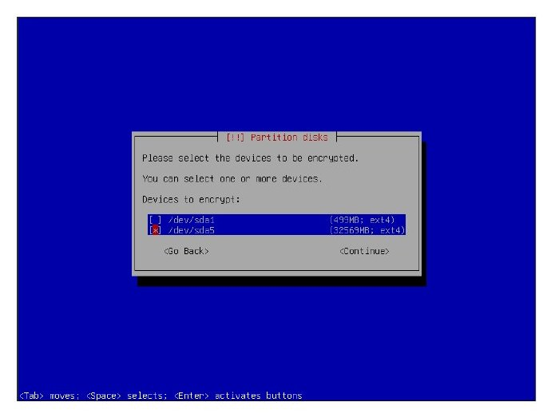</a><figcaption>Step 34: Encrypted storage and partitioning.</figcaption></figure><br>
<figure><a href="README-images/vm-setup/page-035.jpg">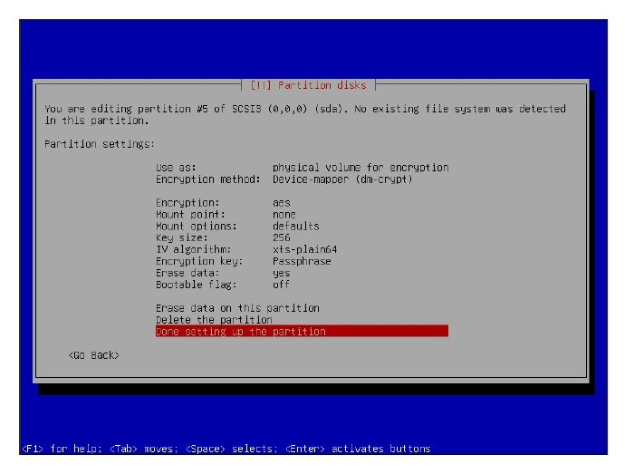</a><figcaption>Step 35: Encrypted storage and partitioning.</figcaption></figure><br>
<figure><a href="README-images/vm-setup/page-036.jpg">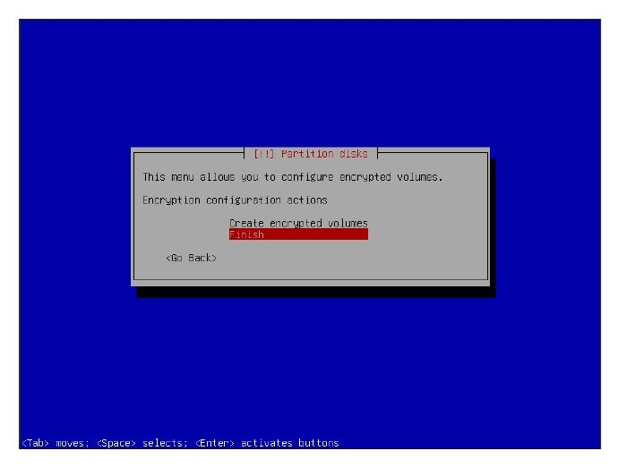</a><figcaption>Step 36: Encrypted storage and partitioning.</figcaption></figure><br>
<figure><a href="README-images/vm-setup/page-037.jpg">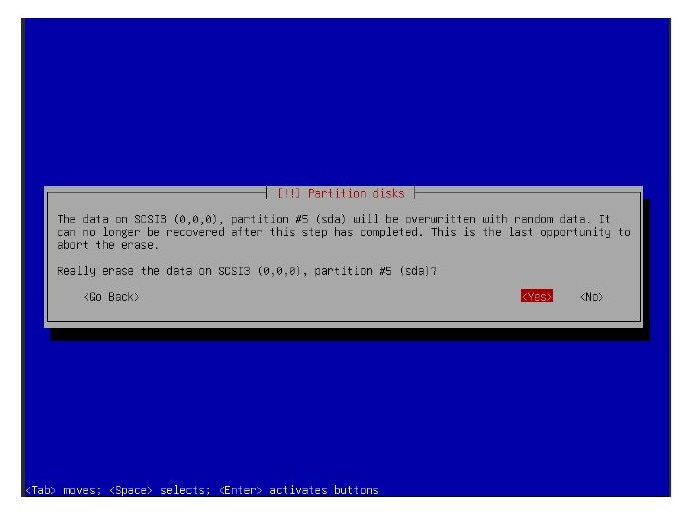</a><figcaption>Step 37: Encrypted storage and partitioning.</figcaption></figure><br>
<figure><a href="README-images/vm-setup/page-038.jpg">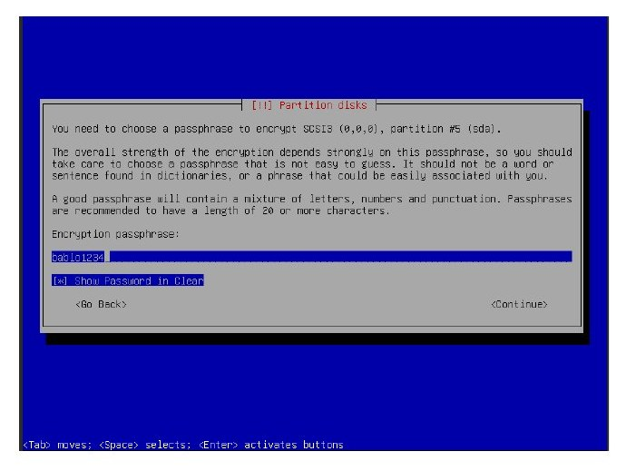</a><figcaption>Step 38: Encrypted storage and partitioning.</figcaption></figure><br>
<figure><a href="README-images/vm-setup/page-039.jpg">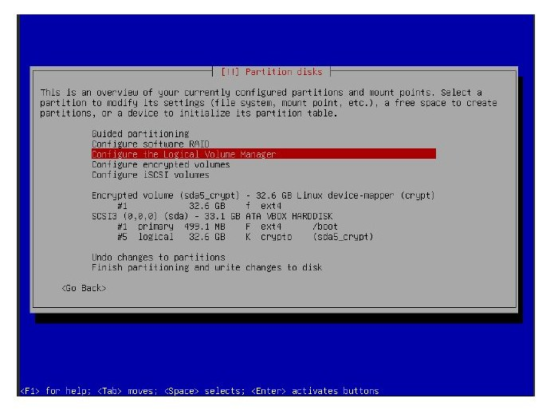</a><figcaption>Step 39: Encrypted storage and partitioning.</figcaption></figure><br>
<figure><a href="README-images/vm-setup/page-040.jpg">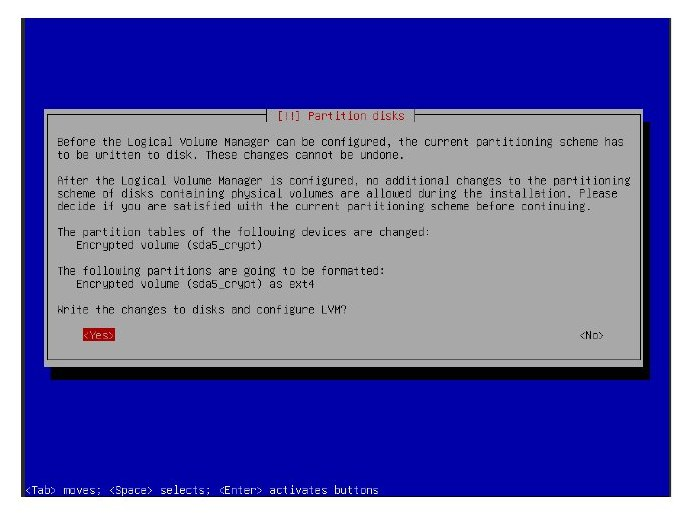</a><figcaption>Step 40: Encrypted storage and partitioning.</figcaption></figure><br>
<figure><a href="README-images/vm-setup/page-041.jpg">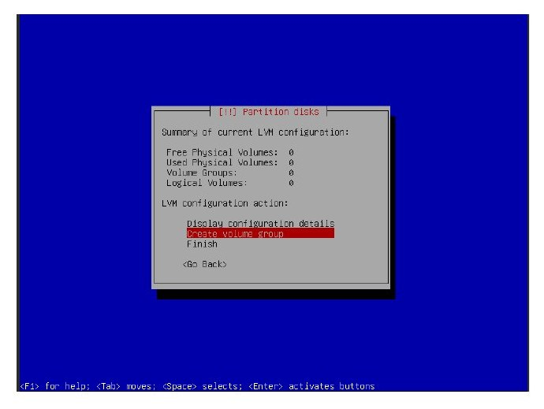</a><figcaption>Step 41: Encrypted storage and partitioning.</figcaption></figure><br>
<figure><a href="README-images/vm-setup/page-042.jpg">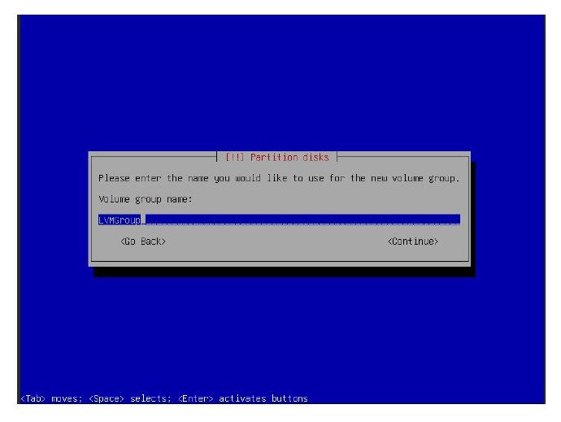</a><figcaption>Step 42: Encrypted storage and partitioning.</figcaption></figure><br>
<figure><a href="README-images/vm-setup/page-043.jpg">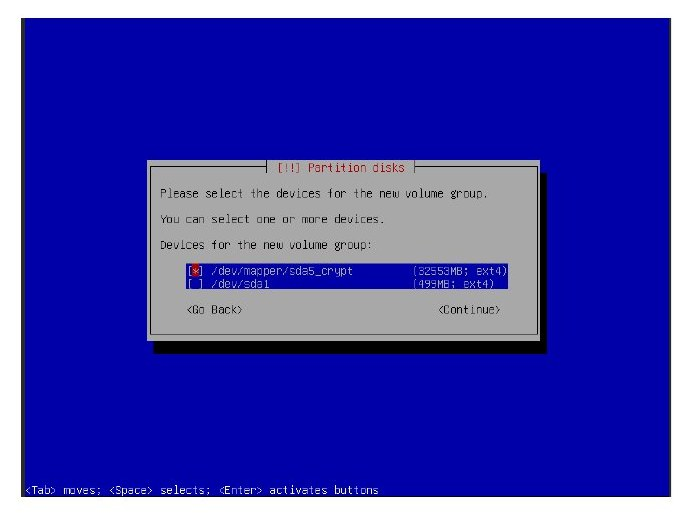</a><figcaption>Step 43: Encrypted storage and partitioning.</figcaption></figure><br>
<figure><a href="README-images/vm-setup/page-044.jpg">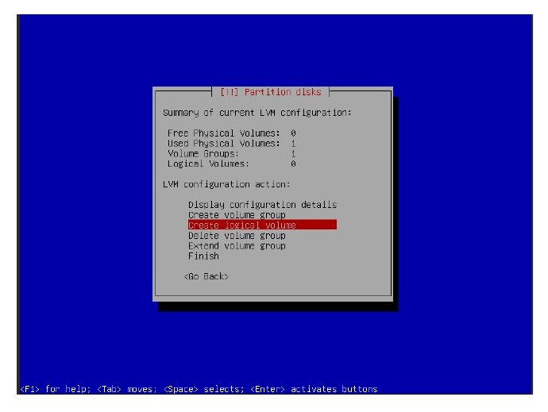</a><figcaption>Step 44: Encrypted storage and partitioning.</figcaption></figure><br>
<figure><a href="README-images/vm-setup/page-045.jpg">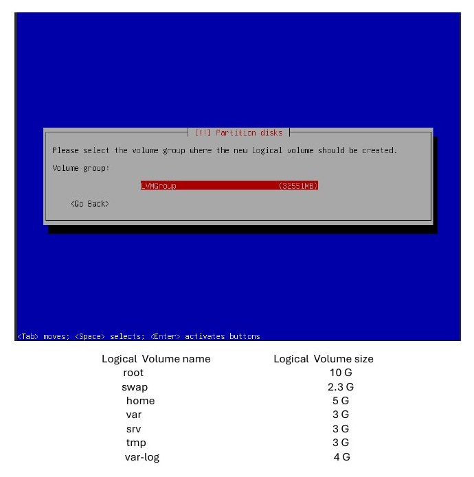</a><figcaption>Step 45: Logical-volume and filesystem review.</figcaption></figure><br>
<figure><a href="README-images/vm-setup/page-046.jpg">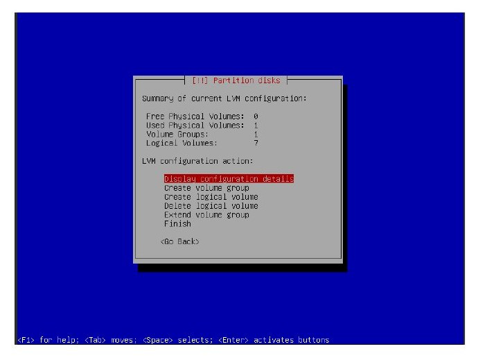</a><figcaption>Step 46: Logical-volume and filesystem review.</figcaption></figure><br>
<figure><a href="README-images/vm-setup/page-047.jpg">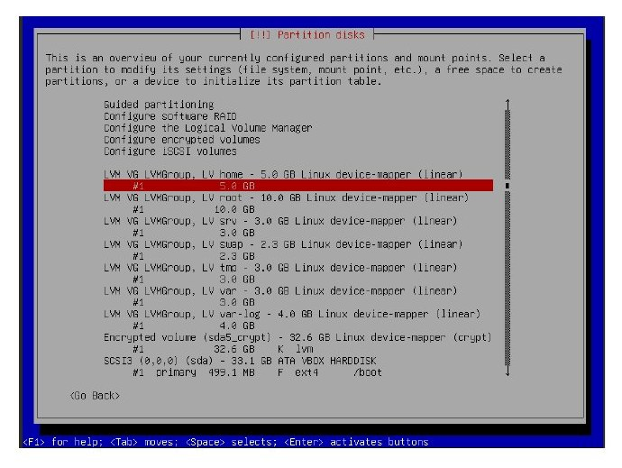</a><figcaption>Step 47: Logical-volume and filesystem review.</figcaption></figure><br>
<figure><a href="README-images/vm-setup/page-048.jpg">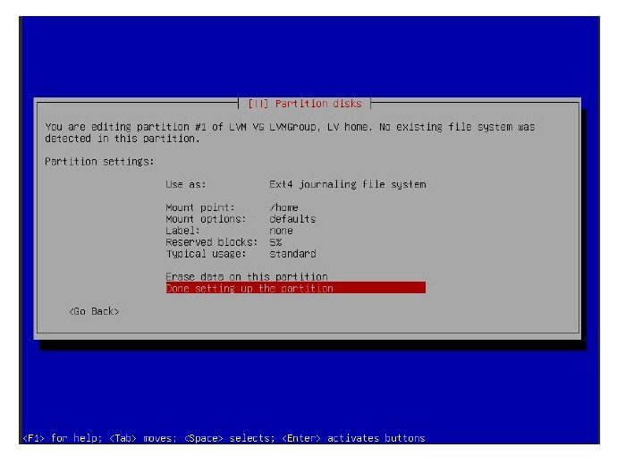</a><figcaption>Step 48: Logical-volume and filesystem review.</figcaption></figure><br>
<figure><a href="README-images/vm-setup/page-049.jpg">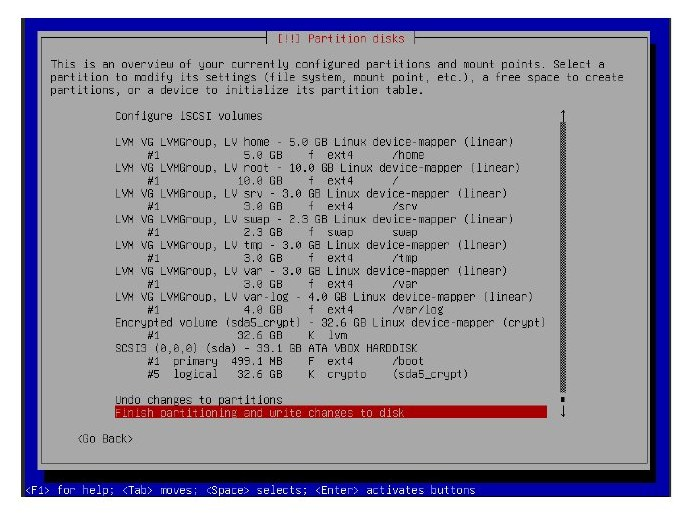</a><figcaption>Step 49: Logical-volume and filesystem review.</figcaption></figure><br>
<figure><a href="README-images/vm-setup/page-050.jpg">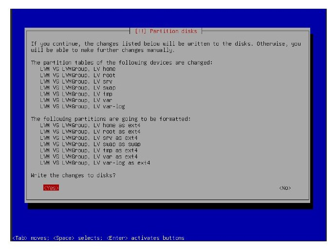</a><figcaption>Step 50: Logical-volume and filesystem review.</figcaption></figure><br>
<figure><a href="README-images/vm-setup/page-051.jpg">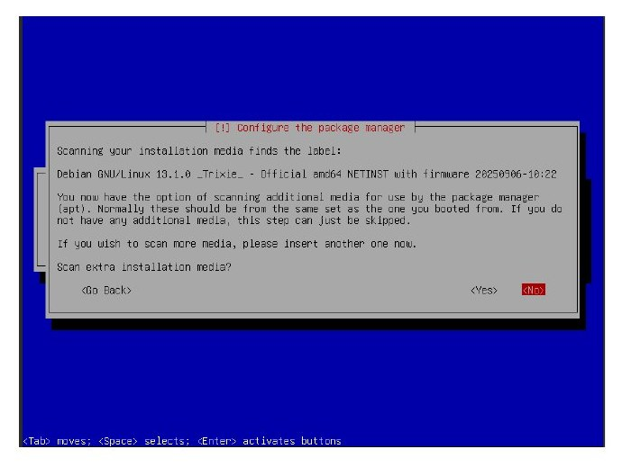</a><figcaption>Step 51: Logical-volume and filesystem review.</figcaption></figure><br>
<figure><a href="README-images/vm-setup/page-052.jpg"></a><figcaption>Step 52: Logical-volume and filesystem review.</figcaption></figure><br>
<figure><a href="README-images/vm-setup/page-053.jpg"></a><figcaption>Step 53: Logical-volume and filesystem review.</figcaption></figure><br>
<figure><a href="README-images/vm-setup/page-054.jpg"></a><figcaption>Step 54: Logical-volume and filesystem review.</figcaption></figure><br>
<figure><a href="README-images/vm-setup/page-055.jpg"></a><figcaption>Step 55: Logical-volume and filesystem review.</figcaption></figure><br>
<figure><a href="README-images/vm-setup/page-056.jpg"></a><figcaption>Step 56: Logical-volume and filesystem review.</figcaption></figure><br>
<figure><a href="README-images/vm-setup/page-057.jpg"></a><figcaption>Step 57: Logical-volume and filesystem review.</figcaption></figure><br>
<figure><a href="README-images/vm-setup/page-058.jpg"></a><figcaption>Step 58: Logical-volume and filesystem review.</figcaption></figure><br>
<figure><a href="README-images/vm-setup/page-059.jpg"></a><figcaption>Step 59: Logical-volume and filesystem review.</figcaption></figure><br>
</div>

</details>

## Project goals

The mandatory configuration should provide:

- A Debian virtual machine with a hostname ending in `42`.
- Encrypted storage using **LUKS** and logical volumes managed by **LVM**.
- A non-root administrative user belonging to the `sudo` and `user42` groups.
- SSH access on port `4242`.
- An active UFW firewall that allows only the required services.
- A strong password policy and password aging rules.
- Restricted and logged `sudo` usage.
- A monitoring script that broadcasts system information to logged-in users.
- AppArmor enabled and enforcing its profiles.

## Expected system

Record the actual values used by this installation:

| Item | Value |
|---|---|
| Operating system | Debian GNU/Linux `__VERSION__` |
| Hostname | `__HOSTNAME__` |
| Main username | `__USERNAME__` |
| VM IP address | `__IP_ADDRESS__` |
| SSH port | `4242` |
| Root filesystem | `__FILESYSTEM__` |
| Signature/hash for submission | `__SIGNATURE__` |

Useful commands:

```bash
cat /etc/os-release
hostnamectl
whoami
ip address
lsblk
```

## Installation and storage

### LUKS and LVM

### LVM and storage evidence

<div align="center">
<figure><a href="README-images/embedded/page-060-01.png"></a><figcaption>PDF page 60, image 1: `lsblk` confirms the 30.3 GB disk, `/boot`, encrypted `sda5_crypt`, root/home/var/srv/tmp/var-log logical volumes, and swap.</figcaption></figure><br>
</div>

LUKS encrypts the block device. The unlock passphrase is requested during boot. LVM then provides flexible logical volumes inside an encrypted volume group.

The PDF shows the following logical-volume plan:

| Logical volume | Size shown in the PDF |
|---|---:|
| `root` | 10 GB |
| `swap` | 2.3 GB |
| `home` | 5 GB |
| `var` | 3 GB |
| `srv` | 3 GB |
| `tmp` | 3 GB |
| `var-log` | 4 GB |

The exact filesystem types, mount options, physical volume name, volume group name, and final free space must be confirmed from the installed VM; they are not reliably specified in the PDF.

```bash
lsblk -f
sudo pvs
sudo vgs
sudo lvs
findmnt
```

Do not place an encryption passphrase in this README.

## Users, groups, and sudo

### Sudo evidence

<div align="center">
<figure><a href="README-images/embedded/page-062-01.png"></a><figcaption>PDF page 62, image 1: Sudo is installed from the root account before normal users can use delegated administration.</figcaption></figure><br>
<figure><a href="README-images/embedded/page-063-01.png"></a><figcaption>PDF page 63, image 1: The Sudo package/version is checked after installation.</figcaption></figure><br>
<figure><a href="README-images/embedded/page-064-01.png"></a><figcaption>PDF page 64, image 1: The required `user42` group is created.</figcaption></figure><br>
<figure><a href="README-images/embedded/page-065-01.png"></a><figcaption>PDF page 65, image 1: The administrative user is added to both `sudo` and `user42`.</figcaption></figure><br>
<figure><a href="README-images/embedded/page-070-01.png"></a><figcaption>PDF page 70, image 1: The Sudo-password policy section begins.</figcaption></figure><br>
<figure><a href="README-images/embedded/page-070-02.png"></a><figcaption>PDF page 70, image 2: The Sudo-password policy section begins.</figcaption></figure><br>
<figure><a href="README-images/embedded/page-071-01.png"></a><figcaption>PDF page 71, image 1: The Sudo policy preparation continues; the project-specific settings are explained in Markdown below.</figcaption></figure><br>
<figure><a href="README-images/embedded/page-071-02.png"></a><figcaption>PDF page 71, image 2: The Sudo policy preparation continues; the project-specific settings are explained in Markdown below.</figcaption></figure><br>
</div>

### Create the required groups and user

```bash
sudo groupadd user42
sudo adduser <username>
sudo usermod -aG sudo,user42 <username>
```

Log out and back in, then verify:

```bash
groups <username>
id <username>
sudo -l -U <username>
```

The `-a` option in `usermod -aG` is important: without `-a`, the user's supplementary groups can be replaced instead of preserved.

### User and group command reference

```bash
# Create a user with its home directory and password prompt
sudo adduser <username>

# Create a user without the interactive setup
sudo useradd <username>
sudo passwd <username>
sudo mkdir -p /home/<username>
sudo usermod -s /bin/bash <username>

# Switch users
su - <username>
sudo su -
exit

# Inspect users, groups, and login history
cat /etc/passwd
sudo cat /etc/shadow
cat /etc/group
groups
id <username>
last <username>

# Rename a user and move its home directory
sudo usermod -l <new-name> <old-name>
sudo usermod -d /home/<new-name> -m <new-name>

# Change group membership
sudo groupmod -n <new-group> <old-group>
sudo usermod -g <primary-group> <username>

# Remove a user
sudo deluser <username>
sudo userdel <username>
sudo userdel -r <username>  # also removes the home directory
```

Use the destructive commands only after confirming the username and home directory.

### Sudo policy

Create a dedicated file rather than editing `/etc/sudoers` directly:

```bash
sudo visudo -f /etc/sudoers.d/sudopass
```

Example policy:

```sudoers
Defaults        passwd_tries=3
Defaults        badpass_message="Incorrect password"
Defaults        logfile="/var/log/sudo/sudo.log"
Defaults        secure_path="/usr/local/sbin:/usr/local/bin:/usr/sbin:/usr/bin:/sbin:/bin"
```

The PDF includes `requiretty`, but this is not available on every Debian configuration and can break valid SSH use. Add it only if the installed system and project evaluator explicitly require it.

Validate the file before leaving `visudo`:

```bash
sudo visudo -c
sudo install -d -m 750 /var/log/sudo
sudo touch /var/log/sudo/sudo.log
sudo chmod 640 /var/log/sudo/sudo.log
```

Check the result:

```bash
sudo -l
sudo tail -n 20 /var/log/sudo/sudo.log
```

### Root versus sudo

`root` is the account with unrestricted administrative privileges. `sudo` temporarily runs a specific command with delegated privileges and records the action. Using `sudo` is safer on a multi-user system because permissions can be limited to selected users or groups and accidental commands are easier to audit.

## System administration command reference

```bash
# Host and power management
sudo hostnamectl set-hostname <hostname>
sudo shutdown now
sudo reboot

# Services
sudo systemctl start <service>
sudo systemctl stop <service>
sudo systemctl restart <service>
sudo systemctl status <service>

# Packages
sudo apt update
sudo apt upgrade
sudo apt install <package>
sudo apt remove <package>

# Files and permissions
sudo nano /etc/hosts
sudo chown <user>:<group> <file>
sudo chmod 755 <file>

# Archives and search
tar -czvf archive.tar.gz directory/
tar -xzvf archive.tar.gz
unzip archive.zip
find / -name '<filename>' 2>/dev/null
```

## SSH

### SSH evidence

<div align="center">
<figure><a href="README-images/embedded/page-074-01.png"></a><figcaption>PDF page 74, image 1: OpenSSH server installation begins after updating package repositories.</figcaption></figure><br>
<figure><a href="README-images/embedded/page-075-01.png"></a><figcaption>PDF page 75, image 1: The SSH service is checked after installation.</figcaption></figure><br>
<figure><a href="README-images/embedded/page-076-01.png"></a><figcaption>PDF page 76, image 1: The server configuration changes the listening port to `4242`.</figcaption></figure><br>
<figure><a href="README-images/embedded/page-077-01.png"></a><figcaption>PDF page 77, image 1: The client configuration is separate from the server configuration.</figcaption></figure><br>
<figure><a href="README-images/embedded/page-078-01.png"></a><figcaption>PDF page 78, image 1: An SSH connection is tested using the configured port.</figcaption></figure><br>
<figure><a href="README-images/embedded/page-079-01.png"></a><figcaption>PDF page 79, image 1: Connection evidence from the SSH setup.</figcaption></figure><br>
<figure><a href="README-images/embedded/page-080-01.png"></a><figcaption>PDF page 80, image 1: The connection is continued from the host computer.</figcaption></figure><br>
<figure><a href="README-images/embedded/page-080-02.png"></a><figcaption>PDF page 80, image 2: The connection is continued from the host computer.</figcaption></figure><br>
</div>

Install and enable the server:

```bash
sudo apt update
sudo apt install openssh-server
sudo systemctl enable --now ssh
```

Edit the server configuration:

```bash
sudoedit /etc/ssh/sshd_config
```

Required hardening:

```text
Port 4242
PermitRootLogin no
```

If key-only authentication is configured, add and verify the key first:

```text
PasswordAuthentication no
```

Then validate and restart:

```bash
sudo sshd -t
sudo systemctl restart ssh
sudo systemctl status ssh --no-pager
```

Connect from the host:

```bash
ssh -p 4242 <username>@<vm-ip>
```

The client file `/etc/ssh/ssh_config` is different from `/etc/ssh/sshd_config`: the former controls client defaults, while the latter controls the server. The PDF contains an inconsistent client port example (`2222`); use `4242` when connecting to this VM unless a different client profile is deliberately configured.

The SSH images above are supporting evidence. Before submission, add final output showing `sshd -t`, the listening port, and a successful connection from the host.

### SSH concepts

SSH means **Secure Shell**. It provides encrypted remote administration, authentication with passwords or keys, and secure file transfer through SCP or SFTP. SSH uses TCP so packets are delivered reliably and in order.

`TTY1` is a local terminal, while SSH is a remote terminal over TCP/IP. Local access is useful when the network is unavailable; SSH is useful for secure remote administration.

## UFW firewall

### UFW evidence

<div align="center">
<figure><a href="README-images/embedded/page-083-01.png"></a><figcaption>PDF page 83, image 1: UFW is installed.</figcaption></figure><br>
<figure><a href="README-images/embedded/page-084-01.png"></a><figcaption>PDF page 84, image 1: UFW is enabled, port `4242` is allowed, and the active rules are checked.</figcaption></figure><br>
</div>

Install and configure UFW before enabling it:

```bash
sudo apt install ufw
sudo ufw default deny incoming
sudo ufw default allow outgoing
sudo ufw allow 4242/tcp
sudo ufw enable
sudo ufw status verbose
```

If the optional WordPress service is installed, allow HTTP only when it is required:

```bash
sudo ufw allow 80/tcp
```

An established SSH connection may remain open after enabling UFW, but a new connection is accepted only when its port is allowed. Always add the SSH rule before enabling the firewall.

> The supplied evidence includes the UFW rule output inside the WordPress/bonus terminal work. It shows ports `4242` and `80` allowed. For the mandatory part, keep only `4242/tcp` unless HTTP is intentionally part of the bonus.

### UFW and iptables

UFW is a simpler interface for the Linux firewall rules implemented by netfilter/iptables. Each rule controls packet direction and can be restricted by port and protocol:

- TCP is connection-oriented and confirms delivery; SSH and HTTP normally use TCP.
- UDP has lower overhead and no delivery guarantee; DNS and some streaming workloads use UDP.
- `deny incoming` blocks unsolicited inbound traffic by default.
- `allow outgoing` permits outbound traffic unless another rule restricts it.

An existing SSH session can remain open after UFW is enabled because the session was already established. A new session still needs an allowed rule.

Useful commands:

```bash
sudo ufw status numbered
sudo ufw delete allow 4242/tcp
sudo ufw disable
```

## Password policy

### Password policy evidence

<div align="center">
<figure><a href="README-images/embedded/page-088-01.png"></a><figcaption>PDF page 88, image 1: Password hardening begins with `/etc/login.defs`.</figcaption></figure><br>
<figure><a href="README-images/embedded/page-089-01.png"></a><figcaption>PDF page 89, image 1: Password-aging evidence from the installed system.</figcaption></figure><br>
<figure><a href="README-images/embedded/page-090-01.png"></a><figcaption>PDF page 90, image 1: The current password-aging values are listed with `chage -l`.</figcaption></figure><br>
<figure><a href="README-images/embedded/page-091-01.png"></a><figcaption>PDF page 91, image 1: Password-aging values are applied to the user.</figcaption></figure><br>
<figure><a href="README-images/embedded/page-092-01.png"></a><figcaption>PDF page 92, image 1: The PAM password-quality package is installed.</figcaption></figure><br>
<figure><a href="README-images/embedded/page-093-01.png"></a><figcaption>PDF page 93, image 1: The PAM password configuration file is opened.</figcaption></figure><br>
<figure><a href="README-images/embedded/page-094-01.png"></a><figcaption>PDF page 94, image 1: The final `pam_pwquality.so` rule is shown; its flags are explained below.</figcaption></figure><br>
<figure><a href="README-images/embedded/page-094-02.png"></a><figcaption>PDF page 94, image 2: The final `pam_pwquality.so` rule is shown; its flags are explained below.</figcaption></figure><br>
</div>

Install PAM password-quality support:

```bash
sudo apt install libpam-pwquality
```

In `/etc/pam.d/common-password`, configure the project-approved policy. The PDF documents this example:

```text
password requisite pam_pwquality.so retry=3 minlen=10 ucredit=-1 lcredit=-1 dcredit=-1 maxrepeat=3 reject_username difok=7 enforce_for_root
```

This requires at least 10 characters, uppercase and lowercase letters, a digit, no excessive repeated characters, no username, and a sufficient difference from the previous password.

Configure password aging in `/etc/login.defs`:

```text
PASS_MAX_DAYS 30
PASS_MIN_DAYS 2
PASS_WARN_AGE 7
```

Apply and verify the policy for existing users:

```bash
sudo chage -M 30 -m 2 -W 7 <username>
sudo chage -l <username>
```

The PDF also contains `90/7/14` as an alternative example. Use one consistent policy and verify it against the official subject requirements before evaluation.

## File permissions and jobs

Linux permissions are represented by read (`r`), write (`w`), and execute (`x`) for the owner, group, and other users. Numeric values are `r=4`, `w=2`, and `x=1`:

```text
755 = owner rwx, group r-x, others r-x
700 = owner rwx, group ---, others ---
644 = owner rw-, group r--, others r--
```

Use a scoped permission change when possible:

```bash
chmod u+x script.sh
chmod g+x script.sh
chmod o+x script.sh
```

`chmod +x script.sh` grants execute permission according to the current umask and should be used deliberately.

Background jobs can be inspected and stopped with:

```bash
jobs
kill %1
```

## Monitoring script

### Monitoring and permissions evidence

<div align="center">
<figure><a href="README-images/embedded/page-097-01.png"></a><figcaption>PDF page 97, image 1: The monitoring script section begins.</figcaption></figure><br>
<figure><a href="README-images/embedded/page-098-01.png"></a><figcaption>PDF page 98, image 1: Monitoring-script evidence from the original project.</figcaption></figure><br>
<figure><a href="README-images/embedded/page-099-01.png"></a><figcaption>PDF page 99, image 1: The Bash script, shebang, and `wall` broadcast mechanism are explained below.</figcaption></figure><br>
<figure><a href="README-images/embedded/page-101-01.png"></a><figcaption>PDF page 101, image 1: Permission numbers and background-job commands are demonstrated.</figcaption></figure><br>
</div>

Create `monitoring.sh` with a Bash shebang and make it executable:

```bash
#!/bin/bash

wall "Architecture: $(uname -a)"
wall "CPU physical: $(lscpu | awk -F: '/^CPU\\(s\\)/ {gsub(/ /, \"\", $2); print $2}')"
wall "Memory usage: $(free -m | awk '/^Mem:/ {printf \"%s/%sMB (%.2f%%)\", $3, $2, $3*100/$2}')"
wall "Disk usage: $(df -h --total | awk '/total/ {print $3 \"/\" $2 \" (\" $5 \")\"}')"
wall "CPU load: $(top -bn1 | awk -F'load average:' 'NR==1 {print $2}')"
wall "Last boot: $(who -b | awk '{print $3, $4}')"
wall "LVM use: $(lsblk | grep -q lvm && echo yes || echo no)"
wall "TCP connections: $(ss -ta | grep -c ESTAB)"
wall "User logins: $(who | wc -l)"
wall "Network: $(ip -br address | awk '$1 != \"lo\" {print $1, $3}')"
wall "Sudo commands: $(journalctl _COMM=sudo --since today 2>/dev/null | grep -c COMMAND=)"
```

The exact output format must match the subject's evaluation requirements. Test it:

```bash
chmod +x monitoring.sh
sudo ./monitoring.sh
```

Schedule it every ten minutes using root's crontab:

```bash
sudo crontab -e
*/10 * * * * /absolute/path/to/monitoring.sh
```

Verify the schedule:

```bash
sudo crontab -l
```

> No complete `monitoring.sh` output screenshot was supplied. Add one screenshot showing the script output and another showing `sudo crontab -l`.

## AppArmor

### AppArmor and filesystem evidence

<div align="center">
<figure><a href="README-images/embedded/page-103-01.png"></a><figcaption>PDF page 103, image 1: AppArmor profile status is inspected.</figcaption></figure><br>
<figure><a href="README-images/embedded/page-104-01.png"></a><figcaption>PDF page 104, image 1: AppArmor enforce, complain, and unconfined profile states are explained.</figcaption></figure><br>
<figure><a href="README-images/embedded/page-105-01.png"></a><figcaption>PDF page 105, image 1: AppArmor profile locations and enforce mode are shown.</figcaption></figure><br>
<figure><a href="README-images/embedded/page-106-01.png"></a><figcaption>PDF page 106, image 1: The Linux filesystem hierarchy starts with `/boot` and `/dev`.</figcaption></figure><br>
<figure><a href="README-images/embedded/page-109-01.png"></a><figcaption>PDF page 109, image 1: `/usr/local` and non-standard paths are explained.</figcaption></figure><br>
</div>

AppArmor confines programs with profiles. Profiles can run in:

- **Enforce** mode: policy violations are blocked and logged.
- **Complain** mode: violations are logged but not blocked.

Verify that it is enabled:

```bash
sudo aa-status
systemctl status apparmor --no-pager
```

Profiles are stored in `/etc/apparmor.d/`. To enforce a specific profile:

```bash
sudo aa-enforce /etc/apparmor.d/<profile>
```

## Linux filesystem overview

| Path | Purpose |
|---|---|
| `/boot` | Kernel, initramfs, and bootloader files |
| `/dev` | Device files |
| `/etc` | System and application configuration |
| `/home` | Users' personal directories |
| `/lib` | Essential shared libraries and kernel modules |
| `/proc` | Virtual process and kernel information |
| `/tmp` | Temporary files |
| `/usr` | Installed programs and shared read-only data |
| `/usr/local` | Locally installed software |
| `/var` | Logs, caches, databases, and other changing data |
| `/bin`, `/sbin` | Essential commands and administrative commands; on modern Debian these may be symlinks into `/usr` |

The PDF mentions `/blice` and `/bob`; these are not standard Linux hierarchy directories. Treat them as typos or custom directories, not required system paths.

## Bonus: WordPress

### WordPress bonus evidence

<div align="center">
<figure><a href="README-images/embedded/page-111-01.png"></a><figcaption>PDF page 111, image 1: Lighttpd is installed for the optional WordPress bonus.</figcaption></figure><br>
<figure><a href="README-images/embedded/page-112-01.png"></a><figcaption>PDF page 112, image 1: HTTP port 80 is allowed for the optional web server.</figcaption></figure><br>
<figure><a href="README-images/embedded/page-113-01.png"></a><figcaption>PDF page 113, image 1: WordPress web-server evidence from the original project.</figcaption></figure><br>
<figure><a href="README-images/embedded/page-117-01.png"></a><figcaption>PDF page 117, image 1: The WordPress archive is downloaded into `/var/www`.</figcaption></figure><br>
<figure><a href="README-images/embedded/page-118-01.png"></a><figcaption>PDF page 118, image 1: The archive is extracted.</figcaption></figure><br>
<figure><a href="README-images/embedded/page-119-01.png"></a><figcaption>PDF page 119, image 1: The existing web root is backed up before replacement.</figcaption></figure><br>
<figure><a href="README-images/embedded/page-120-01.png"></a><figcaption>PDF page 120, image 1: The extracted WordPress directory becomes `/var/www/html`.</figcaption></figure><br>
<figure><a href="README-images/embedded/page-124-01.png"></a><figcaption>PDF page 124, image 1: MariaDB security initialization is run.</figcaption></figure><br>
<figure><a href="README-images/embedded/page-125-01.png"></a><figcaption>PDF page 125, image 1: The MariaDB administrative client is opened.</figcaption></figure><br>
<figure><a href="README-images/embedded/page-126-01.png"></a><figcaption>PDF page 126, image 1: A dedicated WordPress database user receives database privileges; the visible password must never be reused.</figcaption></figure><br>
<figure><a href="README-images/embedded/page-129-01.png"></a><figcaption>PDF page 129, image 1: PHP CGI and the MariaDB PHP driver are installed.</figcaption></figure><br>
<figure><a href="README-images/embedded/page-130-01.png"></a><figcaption>PDF page 130, image 1: `wp-config.php` is created and configured.</figcaption></figure><br>
<figure><a href="README-images/embedded/page-131-01.png"></a><figcaption>PDF page 131, image 1: Lighttpd FastCGI and PHP modules are enabled and the service is reloaded.</figcaption></figure><br>
<figure><a href="README-images/embedded/page-132-01.png"></a><figcaption>PDF page 132, image 1: Final WordPress configuration evidence is checked before claiming the bonus.</figcaption></figure><br>
<figure><a href="README-images/embedded/page-132-02.png"></a><figcaption>PDF page 132, image 2: Final WordPress configuration evidence is checked before claiming the bonus.</figcaption></figure><br>
</div>

The PDF describes an optional WordPress installation with Lighttpd, MariaDB, and PHP:

```bash
sudo apt install lighttpd mariadb-server php-cgi php-mysql wget unzip
sudo ufw allow 80/tcp
cd /var/www
sudo wget https://wordpress.org/latest.zip
sudo unzip latest.zip
sudo mv wordpress html
sudo lighty-enable-mod fastcgi
sudo lighty-enable-mod fastcgi-php
sudo systemctl reload lighttpd
```

Create the WordPress database and user with a strong, private password. Do not copy the password shown in the PDF: it is a plaintext example and must be considered compromised.

Before claiming the bonus, verify:

```bash
systemctl status lighttpd --no-pager
systemctl status mariadb --no-pager
php -v
curl -I http://127.0.0.1/
```


### WordPress installation sequence

The PDF's optional section follows this sequence:

1. Install Lighttpd and allow HTTP port `80` in UFW.
2. Download and extract WordPress under `/var/www`.
3. Keep any existing web root as a backup before moving WordPress into `/var/www/html`.
4. Install MariaDB and create a dedicated database and user.
5. Install PHP CGI and the MariaDB PHP driver.
6. Copy `wp-config-sample.php` to `wp-config.php`, then configure the database name, user, host, and a newly generated password.
7. Enable Lighttpd FastCGI and FastCGI-PHP, then reload the service.

Use SQL like the following, replacing every placeholder and never committing the password:

```sql
CREATE DATABASE wp_database;
CREATE USER 'wp_user'@'localhost' IDENTIFIED BY '<strong-private-password>';
GRANT ALL PRIVILEGES ON wp_database.* TO 'wp_user'@'localhost';
FLUSH PRIVILEGES;
EXIT;
```